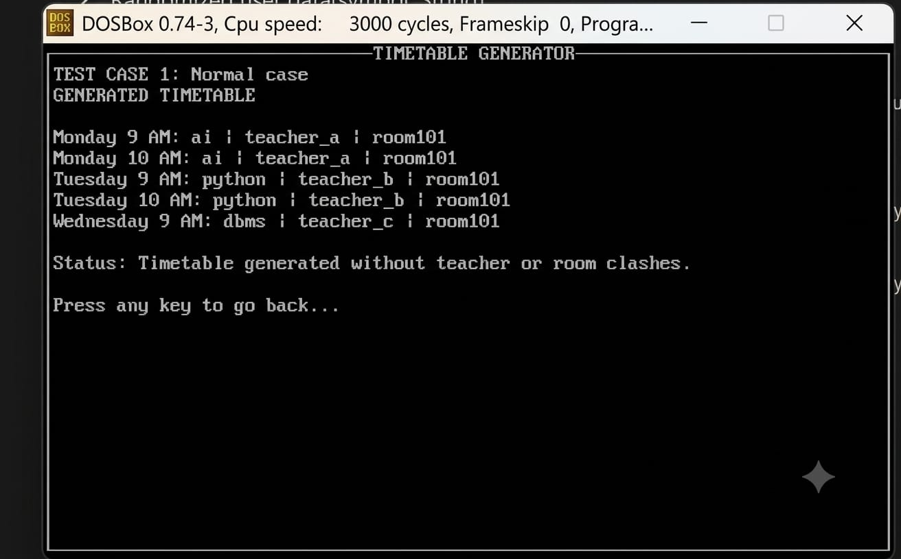
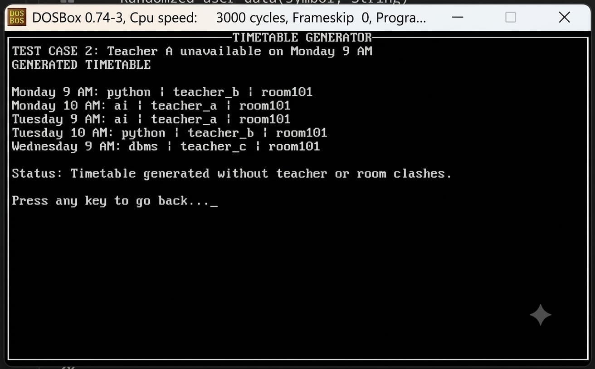
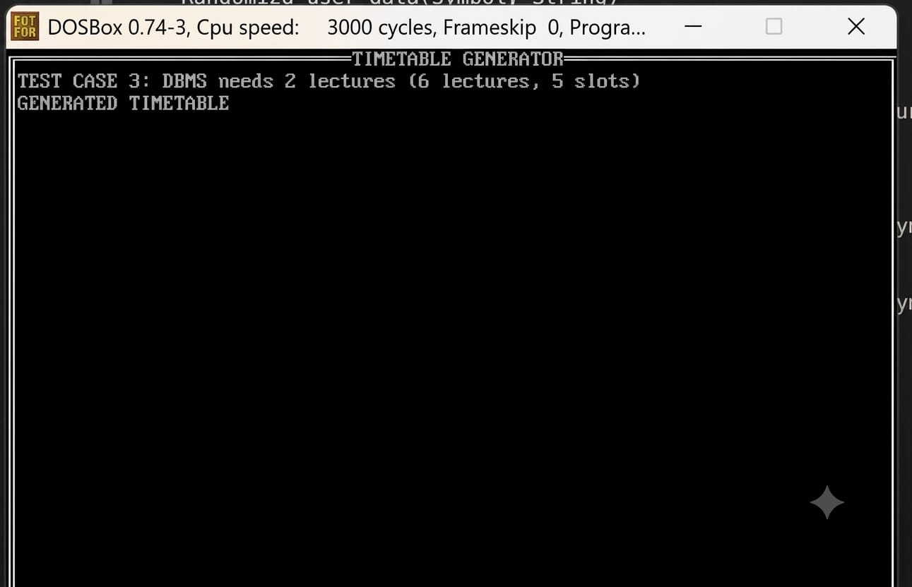

# AI Lab

## Introduction
This repository contains solutions to three Artificial Intelligence lab problems implemented using Python.

## Problems Included

### 1. Water Jug Problem
Uses Breadth-First Search (BFS) to find a sequence of steps to measure the target amount of water.

File: `water_jug.py`

### 2. Missionaries and Cannibals Problem
Uses BFS to find a valid sequence of boat crossings while ensuring that missionaries are never outnumbered by cannibals on either bank.

File: `missionaries_cannibals.py`

### 3. Sudoku Solver
Uses backtracking to solve a Sudoku puzzle. Enter `0` for empty cells.

File: `sudoku_solver.py`

## Requirements
- Python 3.x

## How to Run
Open a terminal in the project folder and run:

```bash
python water_jug.py
```

```bash
python missionaries_cannibals.py
```

```bash
python sudoku_solver.py
```

## Algorithms Used
- Breadth-First Search (BFS)
- Backtracking

## Language
Python
## Lab Test 2: Intelligent Timetable Generator (Turbo Prolog)

A Turbo Prolog program that generates a clash-free class timetable.

**Folder:** `timetable-generator-prolog`

**Approach**
- Facts store subjects, teachers, lecture counts, rooms, time slots and teacher unavailability.
- A list of lectures is built from the subject facts.
- Each lecture is assigned a slot and a room using backtracking.
- Rules reject a slot if the teacher, the room or the class is already used in that slot.
- If no valid arrangement exists, the program reports that no timetable could be created.

**How to run:** load `tt1.pro` in Turbo Prolog 2.0 (Files, Load), then Run.

**Test cases**
1. `tt1.pro`: normal case, timetable generated.
2. `tt2.pro`: Teacher A unavailable on Monday 9 AM.
3. `tt3.pro`: DBMS needs 2 lectures (6 lectures, 5 slots), so no valid timetable.




